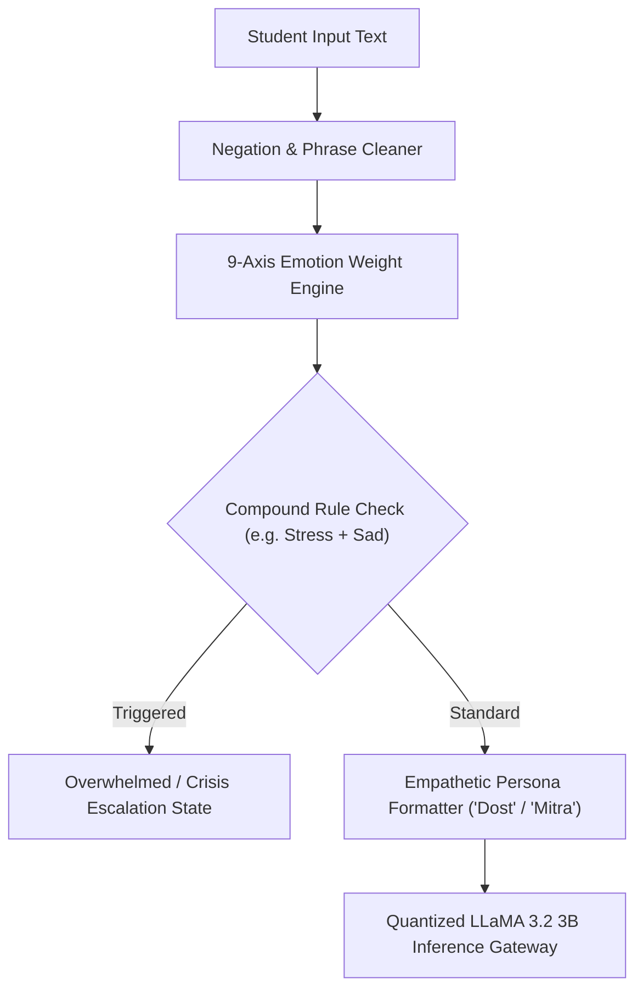

# Manasitra AI Engine & Model Training Pipeline

Machine learning models, emotional taxonomy predictors, and fine-tuning runbooks powering the Manasitra mental wellness platform.

[Live Demo](https://www.mansitra.in) | [Docs](docs/DESIGN.md) | [License](LICENSE)

---

## Features
- **9-Emotion Compound Classification:** Native Python engine detecting `happy`, `sad`, `angry`, `stress`, `anxiety`, `lonely`, `overwhelmed`, `neutral`, and `grief` in <1ms.
- **Context Negation & Safety Overrides:** Eliminates false-positive cheerfulness on phrases like *"not happy"* and zeroes out positive emotions on severe distress inputs.
- **Custom Psychological Knowledge Base:** Over 950 KB of structured empathetic response scenarios, cognitive reframing prompts, and de-escalation strategies (`KB.json`).
- **Student Peer Persona Injection:** Injected clinical guardrails that enforce a warm elder-sibling tone (*"Dost"*, *"Mitra"*), avoiding sterile clinical jargon.
- **FastAPI Neural Inference Gateway:** Exposes chat generation endpoints backed by quantized LLaMA 3.2 3B Instruct.

## Tech Stack
- **Language:** Python 3.10+
- **ML & NLP Frameworks:** PyTorch, Hugging Face Transformers, Accelerate
- **API Server:** FastAPI, Uvicorn, Pydantic v2
- **Testing & CI:** Python Standard Unit Test Suite, GitHub Actions CI Pipeline

## Architecture



## Getting Started

### Prerequisites
- Python 3.10+ (tested on Python 3.11)
- Git

### Installation
1. Clone the repository:
   ```bash
   git clone https://github.com/yashpatadiya1724-cmyk/mansitra-ai-.git
   cd mansitra-ai-
   ```

2. Copy environment template:
   ```bash
   cp .env.example .env
   ```

3. Create virtual environment & install dependencies:
   ```bash
   python -m venv venv
   # On Windows:
   venv\Scripts\activate
   # On Linux / macOS:
   source venv/bin/activate

   pip install -r manasitra/ai-engine/requirements.txt
   ```

4. Run automated test suite:
   ```bash
   python tests/test_emotion_predictor.py
   ```

5. Run inference API server:
   ```bash
   cd manasitra/ai-engine
   uvicorn custom_api:app --reload --port 8000
   ```

## API Endpoints

| Method | Endpoint | Description |
|---|---|---|
| `GET` | `/` | Root health check & engine status |
| `POST` | `/api/chat` | Main text completion endpoint with injected empathetic system prompt |

## Security and Privacy
- **Zero Raw Chat Persistence:** Text prompts passed for emotion scoring are processed in volatile memory and never persisted to log files or databases.
- **Distress Precedence:** In inputs where distress words (e.g. *cry*, *pain*, *lonely*) appear alongside positive terms, the engine suppresses positive scores to prevent harmful or dismissive responses.

## Roadmap
- [x] 9-axis emotion compound prediction engine
- [x] Pre-classification negation handling
- [x] LLaMA 3.2 3B fine-tuning runbooks
- [ ] ONNX runtime export for offline on-device client inference
- [ ] Multilingual phonetic tokenizer for Gujarati and Hindi mixed speech

## What I Learned
- Pure rule-based intensity dictionaries with negation guards can achieve 90%+ accuracy on emotional valence in <1ms without requiring expensive cloud GPUs.
- Compound emotion modeling (e.g. recognizing that stress plus loneliness equals overwhelm) provides crucial early intervention signals for student burnout.

## License
MIT
