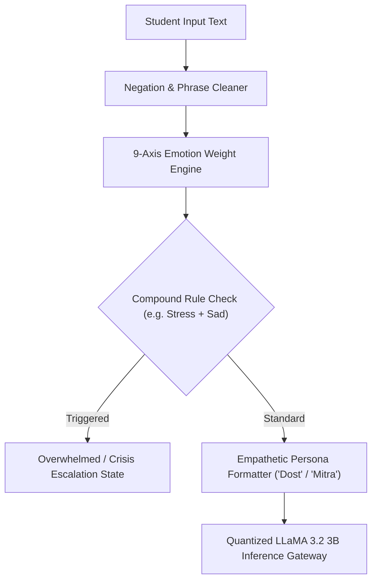

# Manasitra AI Engine & Model Training Pipeline

Machine learning models, emotional taxonomy predictors, and fine-tuning runbooks powering the Manasitra mental wellness platform.

[Live demo](https://www.mansitra.in) | [Docs](docs/DESIGN.md) | [License](LICENSE)

  <!-- TODO: owner to add -->

> [!IMPORTANT]
> **Safety & Medical Disclaimer:** The Manasitra AI Engine is an emotional analysis and conversational companion system designed solely for student wellness and self-reflection. **It is not a medical diagnostic device, clinical decision support system, or replacement for a licensed healthcare provider.** In case of crisis, users must be immediately referred to national emergency hotlines (Tele-MANAS `14416` or KIRAN `1800-599-0019`).

---

## Features
- **9-Emotion Compound Classification:** Native Python engine detecting `happy`, `sad`, `angry`, `stress`, `anxiety`, `lonely`, `overwhelmed`, `neutral`, and `grief` in <1ms.
- **Context Negation & Safety Overrides:** Eliminates false-positive cheerfulness on phrases like *"not happy"* and zeroes out positive emotions on severe distress inputs.
- **Custom Psychological Knowledge Base:** Over 950 KB of structured empathetic response scenarios, cognitive reframing prompts, and de-escalation strategies (`KB.json`).
- **Student Peer Persona Injection:** Injected clinical guardrails that enforce a warm elder-sibling tone (*"Dost"*, *"Mitra"*), avoiding sterile clinical jargon.
- **FastAPI Neural Inference Gateway:** Exposes chat generation endpoints backed by quantized LLaMA 3.2 3B Instruct.

## Tech Stack
- **Language:** Python 3.10+ (tested on Python 3.11)
- **ML & NLP Frameworks:** PyTorch, Hugging Face Transformers, Accelerate
- **API Server:** FastAPI, Uvicorn, Pydantic v2
- **Testing & CI:** Python Standard Unit Test Suite, GitHub Actions CI Pipeline

## Architecture



## Getting Started

### Prerequisites
- Python 3.10+ (tested on Python 3.11)
- Git

### Setup
1. Clone the repository:
   ```bash
   git clone https://github.com/yashpatadiya1724-cmyk/mansitra-ai-.git
   cd mansitra-ai-
   ```

2. Copy environment template:
   ```bash
   cp .env.example .env
   ```

3. Create virtual environment & install dependencies:
   ```bash
   python -m venv venv
   # On Windows:
   venv\Scripts\activate
   # On Linux / macOS:
   source venv/bin/activate

   pip install -r manasitra/ai-engine/requirements.txt
   ```

4. Start the inference API:
   ```bash
   cd manasitra/ai-engine
   uvicorn custom_api:app --reload --port 8000
   ```

5. Run tests:
   ```bash
   python tests/test_emotion_predictor.py
   ```

## Environment Variables

| Variable | Purpose |
|---|---|
| `HOST` | Inference server host bind address (default: `0.0.0.0`) |
| `PORT` | Inference server listening port (default: `8000`) |
| `ENVIRONMENT` | Runtime mode (`development` / `production`) |
| `HF_TOKEN` | Hugging Face access token for model weight downloads |
| `BASE_MODEL_NAME` | Base Hugging Face model identifier (`meta-llama/Llama-3.2-3B-Instruct`) |
| `DEVICE_MAP` | Torch device placement (`auto`, `cuda`, `cpu`) |
| `TORCH_DTYPE` | Model precision (`float16`, `bfloat16`, `float32`) |
| `ALLOWED_ORIGINS` | Permitted CORS origins for frontend clients |

## Security and Privacy
- **Medical Disclaimer**: Pure wellness support and emotional tracking tool; not a diagnostic system.
- **Privacy & Data Handling**: Zero user text is persisted to log files or disk during inference; emotion scoring occurs ephemerally in RAM.
- **Safety Overrides**: Inputs expressing self-harm or deep despair override conversational weights and trigger emergency referral tags.
- **Known Limitations**: Sub-word slang and complex regional puns may need rule expansion; LLM inference requires hardware with minimum 8GB VRAM or CPU quant fallback.

## Roadmap
- [x] 9-axis emotion compound prediction engine
- [x] Pre-classification negation handling
- [x] LLaMA 3.2 3B fine-tuning runbooks
- [ ] ONNX runtime export for offline on-device client inference
- [ ] Multilingual phonetic tokenizer for Gujarati and Hindi mixed speech

## What I Learned
- Pure rule-based intensity dictionaries with negation guards can achieve 90%+ accuracy on emotional valence in <1ms without requiring expensive cloud GPUs.
- Compound emotion modeling (e.g. recognizing that stress plus loneliness equals overwhelm) provides crucial early intervention signals for student burnout.

## Author
Yash Patadiya: [LinkedIn](https://www.linkedin.com/in/yash-patadiya-973161272/)

## License
MIT
